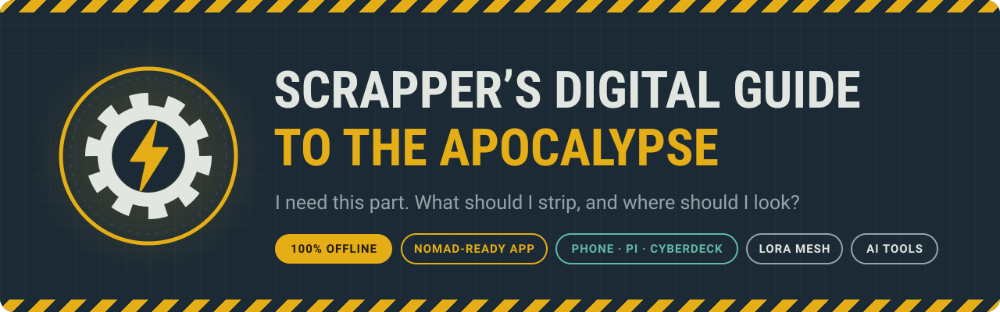
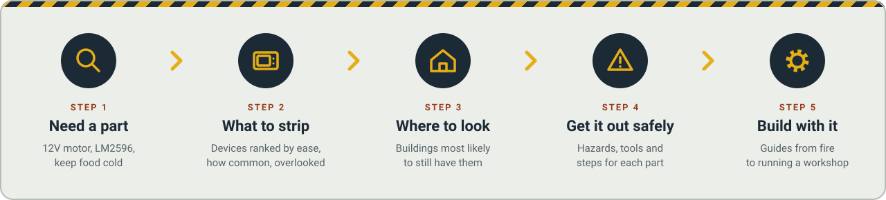
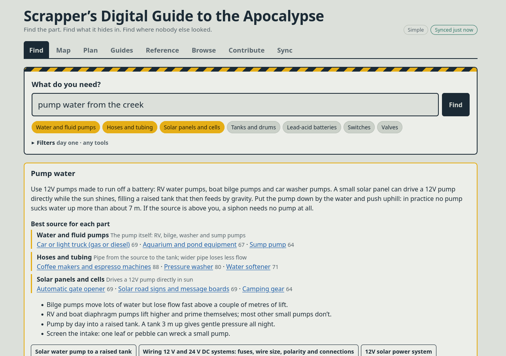
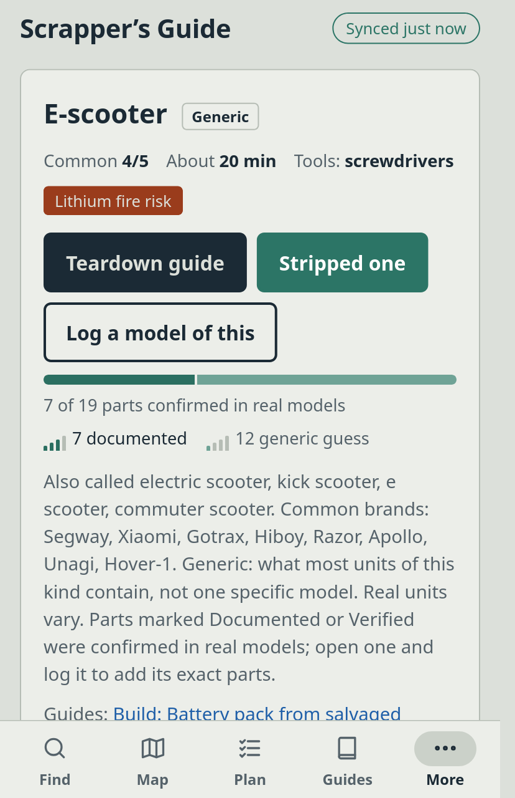
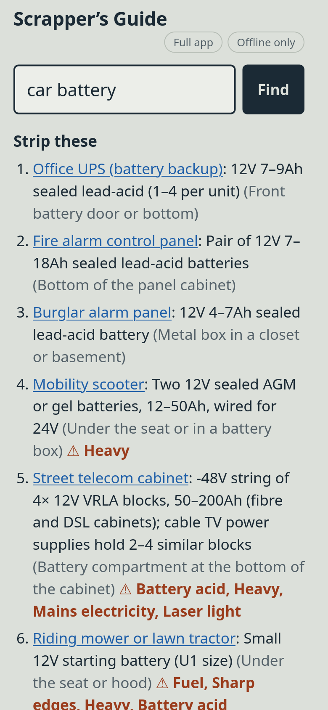
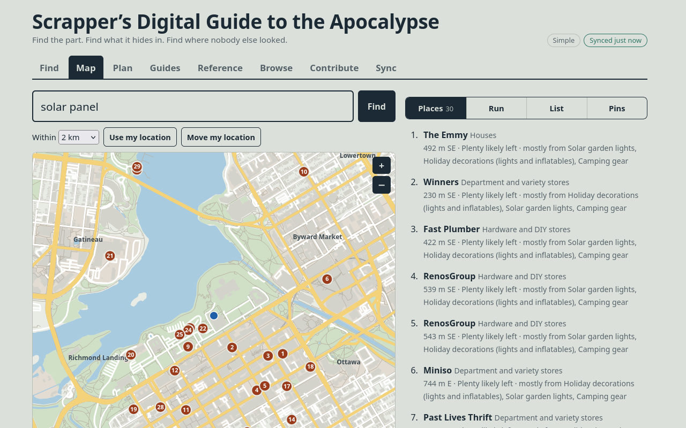
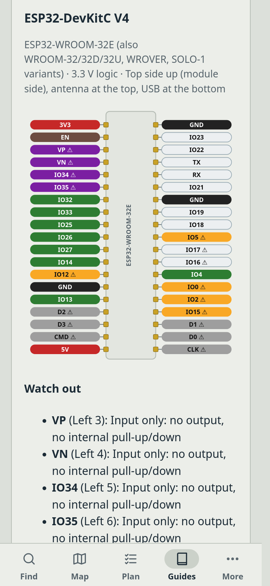
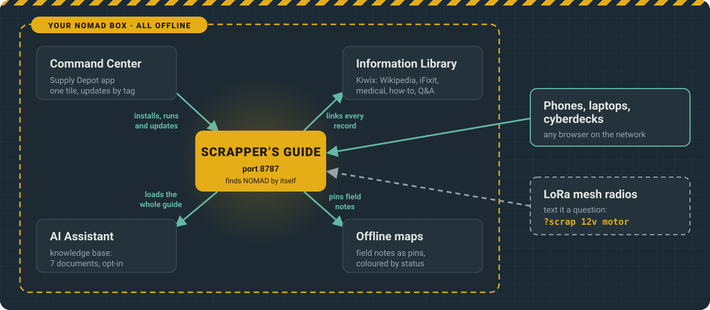
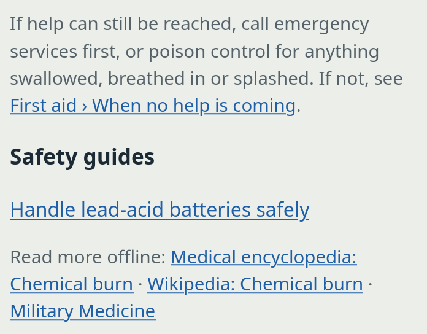
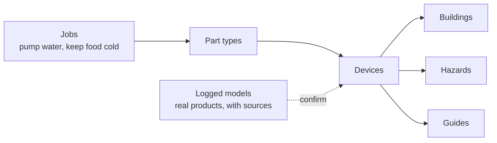

<p align="center">
  
</p>

<p align="center">
  <a href="#built-for-project-nomad"></a>
  
  <a href="#licenses"></a>
</p>

<p align="center">
  <a href="#what-it-does">What it does</a> ·
  <a href="#how-much-to-trust-it">Trust</a> ·
  <b><a href="#built-for-project-nomad">NOMAD</a></b> ·
  <a href="#run-a-hub-or-a-node">Run a hub</a> ·
  <a href="#contribute">Contribute</a> ·
  <a href="#read-next">Docs</a>
</p>

---

An offline salvage and survival database: what’s inside everyday devices and appliances, which parts are worth stripping, where to find them, and how to get them out safely. It runs from one HTML file on any phone or laptop, or as an add-on on a [Project NOMAD](#built-for-project-nomad) box.

It answers one question: **I need this part, so what should I strip, and where should I look?**

Type a part (“12V motor”), a part or chip number (“LM2596”), a need (“keep food cold”), a device (“microwave”) or a brand or product (“ryobi”, “AirSense 10”). The guide ranks the devices that hide it by how useful, easy to get and overlooked they are, tells you which kinds of buildings probably still have them, warns you what can hurt you, and shows you how to get the part out. With an offline map it finds the actual places near you and plans a run to get everything on your list.

It works with no internet, ever. It syncs when it can.

**Website:** [crymoarz.github.io/scrappers-guide](https://crymoarz.github.io/scrappers-guide/) has every device, part type, guide and pinout as a page you can read or link to, and the app to open or download. The website counts visits with [GoatCounter](https://www.goatcounter.com/help/privacy): no cookies, and nothing that identifies you is kept. The app itself has no counter of any kind.

> [!IMPORTANT]
> A personal open-source project developed with AI assistance. Its content has not been reviewed by qualified professionals. For educational and emergency-preparedness use only, provided without warranty: see the [disclaimer](#disclaimer).

<p align="center">
  
</p>

## What it does

On a phone, Find, Map, Plan, Guides and More sit along the bottom of the screen where your thumb is. On anything wider they are tabs along the top, with Reference, Browse, Contribute and Sync beside them.

- **Find.** Search by part, number, need or device. The best devices to strip come first, then the building types to look in, with the rest a tap away. Filters fold into one line: months since the collapse (batteries and fuel age, looters take the obvious), the tools you have, and how much you can carry.
- **Map.** On a [Project NOMAD](#built-for-project-nomad) box, or any hub with an offline map, the places near you that hold what you need (shops, schools, hospitals, industrial areas, even street lamps) are ranked by what's probably there, what's probably left and how far it is, out to 50 km. One tap marks a place looted, untouched, dangerous or occupied. Your own markers (home base, stash points, water) never leave your device. See [docs/MAP.md](docs/MAP.md).
- **Plan.** A shopping list of the parts you need, and a run that gets them in the fewest stops; runs with when, how and what to get at each stop, drawn on the map; your stash; your field notes.
- **Guides.** 52 teardowns, each saying what to leave as well as what to take, plus builds, repairs, field tests, skills and safety: 115 in all, including building a LoRa mesh node from parts, a mesh network that covers a whole town, and running it and handing it over. “What can I build?” checks them against your stash.
- **Quick reference** (Reference on a wide screen; on a phone, a switch at the top of Guides), ready to print:
  - **14 calculators:** Ohm’s law, LED resistors, dividers, RC and 555 timers, battery runtime, voltage drop, gears, resistor colour codes, LoRa airtime and range, an engineering calculator that takes 4k7 or 100n, and solar sizing for anywhere in the world, offline, from NASA’s sun data built in: type a place or use your location.
  - **27 cheat sheets:** warning labels and symbols, component codes, wire colours, connectors, what fits what, power draw, battery chemistries, first aid, water and sanitation, food safety, fire and heat, shop chemicals (lye from wood ash included), welding, knots and lifting, vehicles, radio, LoRa frequencies for 211 countries, navigation, weather and more. Where it matters they say what to do when no help is coming.
  - **Microcontrollers:** board pinouts drawn for 26 boards, half of them the Chinese clones most people actually own, with the boot and strapping pins marked; how to get each family into its bootloader and unbrick it; and code templates in Arduino C++ and MicroPython for battery monitors, low-voltage cut-offs, thermostats, motors and sensors.
- **More.** The whole database to browse, a form to log a model you opened, and sync and settings.
- **Simple mode** (under More on a phone, the button at the top on a wider screen): big text, just a search box, what to strip, where to look, what can hurt you and plain numbered steps.

Every part shows how sure the guide is, as one to four bars: a generic guess, likely, documented from a public source, or verified by someone who opened one. People who open one can say **Found it** or **Not in mine**, and three finds turn a guess into likely.

Some device pages also say what the device is made of, and for 27 kinds of device how often repair cafés got one working again and what had usually failed, from 600,000 community repair records: the part to suspect in a dead one.

<p align="center">
  
</p>

<table>
  <tr>
    <td width="50%" valign="top"></td>
    <td width="50%" valign="top"></td>
  </tr>
  <tr>
    <td valign="top"><b>Every device, part and building links to the others.</b> Each part shows how sure the guide is; parts confirmed in real models say so, with the source.</td>
    <td valign="top"><b>Simple mode</b>, from the single file with no connection. Need a car battery? Everyone raids cars first; UPSes, alarm panels and telecom cabinets get overlooked.</td>
  </tr>
  <tr>
    <td valign="top"></td>
    <td valign="top"></td>
  </tr>
  <tr>
    <td valign="top"><b>The map</b> ranks the places near you by what's probably there and what's probably left, from an offline map.</td>
    <td valign="top"><b>Board pinouts</b> for 26 boards and their clones, with the pins that stop a board booting marked.</td>
  </tr>
</table>

**Use it anywhere.** Download `scrappers-guide.html` from the [latest release](https://github.com/CryMoarz/scrappers-guide/releases/latest) (or take `app/scrappers-guide.html` from here) and open it in any modern browser: phone, laptop, cyberdeck. The whole database is inside that one file, so it works from a USB stick with nothing installed. `node tools/export-text.js` writes a printable field guide for when the batteries die. How much storage to set aside for maps and offline libraries, for a pocket kit or a deck: [docs/LIBRARIES.md](docs/LIBRARIES.md).

## How much to trust it

Be clear about what this is before you rely on it.

- **How it was made.** This is a personal, open-source project, built by one person together with Claude, an AI model. Claude wrote most of the code, drafted the device templates and guides, and ran the research; the owner directs it, checks it and decides what goes in, and every commit says who wrote it. It was made this way on purpose: a useful tool in people's hands beats a perfect one that never ships, and what matters is helping people get through, not who typed it. The cost of that is below, and it's why the guide needs people who know the work.
- **Device templates are informed guesses** of what most units of a kind contain, and say so (“Generic”). The ratings that drive the ranking (how easy, how overlooked, how likely in which building) are editorial estimates on a 1–5 scale.
- **Logged models are documented, not verified.** Each part claim comes from a service manual, parts list, FCC filing or teardown, with a link, and a second AI pass checked every claim against its source and dropped what the page didn't show ([how](research/README.md)). Nobody has yet opened one and confirmed it by hand: that is what the app's **Found it** votes and model logging are for. Models imported from open datasets (679 routers from OpenWrt) or still waiting for their fact-check show as likely.
- **Guides have not been reviewed by people who do this work.** The steps are careful and conservative, but treat high-voltage, pressure, heavy-machinery and vehicle guides as a starting point, not a procedure. If you have done the work, please [review one](CONTRIBUTING.md#review-a-guide-for-work-you-know).
- **What has run for real:** the app and hub on a Project NOMAD 1.35.1 box, with its maps. **Simulated only so far:** the LoRa radio bridge. Known gaps and quirks are listed in [docs/LIMITATIONS.md](docs/LIMITATIONS.md).

## Built for Project NOMAD

[Project NOMAD](https://github.com/Crosstalk-Solutions/project-nomad) puts an offline library, maps and a local AI on one box. The Scrapper’s Guide installs on it as an app, finds NOMAD by itself, and wires every record into what’s already there. Tested on a real NOMAD 1.35.1.

**Install it in three steps.** In the Command Center, open **Supply Depot** and choose **Add a custom app**:

| Field | Value |
|---|---|
| Name | `Scrapper's Guide` |
| Image | `ghcr.io/crymoarz/scrappers-guide:4.4.0` |
| Port | container `8787`, host `8787` |
| Volume | host `/opt/project-nomad/storage/scrappers-guide`, container `/guide` |

Click **Install**, then **Open**. There are no addresses to type: the guide finds NOMAD on its network and starts linking.

<p align="center">
  
</p>

| NOMAD piece | What the guide does with it |
|---|---|
| **Information Library** (Kiwix) | Every device, part, hazard and guide gets **Read more offline** links into the books you have installed. It knows 41 libraries and works out which ones are on your box by itself. |
| **Sources** | A source on a site one of your books copies (iFixit, MedlinePlus, Ready.gov, Wikipedia, the Q&A sites, the OpenWrt wiki) gets an **offline** link that opens the copy on your box, or searches the book if its copy lacks that page. |
| **First aid** | Hazard cards link to the medical encyclopedia, Military Medicine and Wikipedia, and burns, cuts and acid injuries also link to NOMAD’s own first-aid pages. |
| **Offline maps** | The Map reads NOMAD’s own maps by itself: download your region at zoom 15 and it finds the shops, schools, hospitals and industrial areas near you that hold what you need. |
| **AI Assistant** | One setting (`SDG_NOMAD_KB=1`) loads the whole guide into its knowledge base as seven documents, so its chat can answer salvage questions. |
| **Updates** | Switch the image tag to a new version and it brings the new records while keeping your key and field notes. |
| **Phones on your network** | Library links point at the box’s own address, so they work from any device that can reach it. |

<p align="center">
  
</p>

<details>
<summary><b>The 41 offline libraries it can link into</b></summary>
<br>

Wikipedia · Medical encyclopedia · iFixit repair guides · wikiHow · Electronics Q&A · Home improvement Q&A · Wikibooks · Project Gutenberg · NOMAD medical conditions · Khan Academy · Appropedia · energypedia · Survivor Library · Low-tech Magazine · CD3WD appropriate technology · Post Disaster Resource Library · Water Treatment Library · Food for Preppers · USDA Guide to Home Canning · Library of Knots · Medical Library · Military Medicine · MedlinePlus · Ready.gov · CDC health information · Vehicle mechanics Q&A · Amateur radio Q&A · Outdoors Q&A · Bicycles Q&A · Engineering Q&A · Woodworking Q&A · Gardening Q&A · Cooking Q&A · Engineering LibreTexts · Learning Self-Reliance · Arduino Q&A · Raspberry Pi Q&A · Robotics Q&A · OpenWrt wiki · C++ reference (DevDocs) · Python reference (DevDocs)

The list and the rules for recognising each library’s books are in [`data/vocab.json`](data/vocab.json), so adding one is a data change, not a code change.
</details>

**Which ones to install:** [docs/LIBRARIES.md](docs/LIBRARIES.md) lists the recommended libraries, their exact Kiwix names and sizes, starting with a 13 GB core set.

Everything else, including running it next to NOMAD without Docker and every setting, is in **[docs/NOMAD.md](docs/NOMAD.md)**.

> [!NOTE]
> The Scrapper’s Guide is an independent project. It works with Project NOMAD but isn’t made or endorsed by its authors.

## What’s inside

| **187** devices | **150** part types | **238** documented models |
|:-:|:-:|:-:|
| **155** guides | **30** quick-reference cards | **14** calculators |
| **41** jobs | **33** hazard cards | **64** building types |
| **23** shared boards | **26** board pinouts | **41** linked libraries |

*Counts for version 4.4.0, plus 679 router and access point models from the OpenWrt hardware table that are not yet fact-checked. The part types include 25 kinds of protective gear. `node tools/validate.js` prints the current numbers; it counts guides and written cards together (183).*

The records cross-link: a job needs part types, part types hide in devices, devices sit in buildings and carry hazards, guides strip them and build with what comes out, and each guide says what to learn first. Logged models of real products confirm what is inside each device.



Device templates are informed guesses; logged models are documented from public sources, claim by claim (see [How much to trust it](#how-much-to-trust-it)). The app shows which is which.

## Run a hub or a node

```bash
node server/hub.js
```

That serves the app, the API and an AI tool endpoint at http://127.0.0.1:8787. It needs Node 20 or newer and nothing else: no `npm install`, no dependencies.

- A **hub** takes contributions, runs moderation and publishes the data.
- A **node** mirrors a hub for a camp, a NOMAD box or a cyberdeck, and syncs whenever it can reach it: `node server/hub.js --mode node --upstream https://hub.example.org`.
- Add a **LoRa radio** and anyone on the mesh can text it `?scrap 12v motor`: `--lora meshtastic-tcp --lora-host 192.168.1.50`. (Tested in simulation; not yet on a real radio.)
- Or run the same image as NOMAD, anywhere with Docker:

```bash
docker run -d --name scrappers-guide --restart unless-stopped -p 8787:8787 -v /srv/scrappers-guide:/guide ghcr.io/crymoarz/scrappers-guide:4.4.0
```

See [docs/RUNNING-A-HUB.md](docs/RUNNING-A-HUB.md), [docs/NOMAD.md](docs/NOMAD.md) and [docs/LORA.md](docs/LORA.md).

## AI assistants

Claude, local models in MCP-capable clients, or anything that reads OpenAPI can use the guide as a tool: `node mcp/stdio.js` offline, or `/mcp` on any hub (read tools everywhere; tools that submit are opt-in on public hubs). Search is deterministic, so an AI front end can phrase the question but can’t invent the answer. NOMAD’s built-in AI reads documents instead, and the guide loads itself into it (above). AI-written contributions are labelled and always reviewed by a person. See [docs/AI-TOOLS.md](docs/AI-TOOLS.md).

## Contribute

Open a device and log what you found. That’s the most valuable thing anyone can do for this project; the next is reviewing a guide for work you know. In the app, make a contributor key in **Sync** (under **More** on a phone), then use **Contribute**. Your changes work on your device at once and go to a hub for review when you’re next online. See [CONTRIBUTING.md](CONTRIBUTING.md).

## Develop

```bash
node tools/validate.js --warn   # check every record and reference
```

```bash
node --test test/*.test.js      # run the tests
```

```bash
node tools/build.js             # build dist/release.json and the app
```

```bash
node tools/test-search.js "keep food cold" "555 timer"
```

Also: `tools/fmt.js` (standard file layout), `tools/export-text.js` (Markdown and a printable field guide), `tools/export-tiny.js` (lookups for microcontrollers), `tools/specs.js` (electrical ratings read from part specs), `tools/import-openwrt.js` (routers from the OpenWrt hardware table), `tools/site.js` (the website, published by the Website workflow), `tools/screenshots.js` (these pictures, with headless Firefox), `tools/keys.js`, `tools/mod.js`, `tools/sync.js`, `tools/lora.js`, `tools/nomad.js`, `tools/research.js`, `tools/migrate-v3.js` (old version 2 exports).

## Read next

| | |
|---|---|
| [VISION.md](VISION.md) | What this is and what it should become |
| [ARCHITECTURE.md](ARCHITECTURE.md) | How data is stored, synced, signed and moderated |
| [CHANGELOG.md](CHANGELOG.md) | What changed in each version |
| [docs/LIMITATIONS.md](docs/LIMITATIONS.md) | What it can't do yet, or does only roughly |
| [docs/NOMAD.md](docs/NOMAD.md) | Everything about running with Project NOMAD |
| [docs/LIBRARIES.md](docs/LIBRARIES.md) | Which offline libraries to install alongside, and what each one adds |
| [docs/MAP.md](docs/MAP.md) | The map: where it comes from, how places are ranked, your location |
| [docs/RUNNING-A-HUB.md](docs/RUNNING-A-HUB.md) | Running a hub or a node, moderation and settings |
| [docs/LORA.md](docs/LORA.md) | The LoRa radio bridge |
| [docs/AI-TOOLS.md](docs/AI-TOOLS.md) and [docs/API.md](docs/API.md) | The AI tool server and the HTTP API |
| [CONTRIBUTING.md](CONTRIBUTING.md) | Every way to help, from one found part to a reviewed guide |
| [CODE_OF_CONDUCT.md](CODE_OF_CONDUCT.md) | How we treat each other, and how to report a problem |
| [docs/DATA-GUIDE.md](docs/DATA-GUIDE.md) | How to write good records |
| [docs/GIT-BASICS.md](docs/GIT-BASICS.md) | Git in plain words, for sending changes as files |
| [research/README.md](research/README.md) | How model data is researched and fact-checked |
| [SECURITY.md](SECURITY.md) | Reporting a security or safety problem |

## Licenses

Code: MIT ([LICENSE](LICENSE)). Data and guides: CC BY-SA 4.0 ([DATA-LICENSE.md](DATA-LICENSE.md)). Brand and model names identify products only.

## Disclaimer

> [!CAUTION]
> Salvage, disassembly and the builds described here involve serious risks, including electric shock, fire, explosion, toxic exposure, injury and death.

**Intended use.** This guide is provided for educational and emergency-preparedness purposes. Use it only on property you own or have permission to work on, and in compliance with all applicable laws and regulations, including those on property and trespass, the handling of refrigerants and hazardous materials, and the disposal of batteries and electronic waste.

**No warranty.** The guide, its data and its software are provided "as is", without warranty of any kind, express or implied (see [LICENSE](LICENSE) and [DATA-LICENSE.md](DATA-LICENSE.md)). The information is general in nature and is not professional, electrical, medical or legal advice. Much of it has not been independently verified (see [How much to trust it](#how-much-to-trust-it)).

**Limitation of liability.** You assume all risk arising from your use of this information. In no event shall the authors or contributors be liable for any injury, damage or loss arising from its use.
